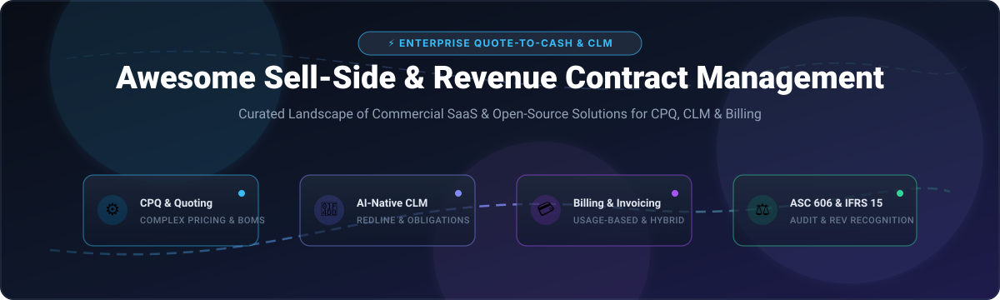

  

# 📑 Awesome Sell-Side & Revenue Contract Management 🚀

> 🌟 **A curated directory of top Sell-Side and Revenue Contract Management platforms** — comparing enterprise SaaS/Hosted commercial solutions with open-source alternatives for orchestrating Configure, Price, Quote (CPQ), Contract Lifecycle Management (CLM), usage-based subscription billing, and ASC 606 / IFRS 15 revenue recognition across modern lead-to-cash workflows.

---

## 📈 Sector Overview & Market Dynamics

The global **Contract Lifecycle Management (CLM)** market is valued at approximately **$2.5 billion to $3.3 billion** and is projected to expand toward **$7.8 billion** by 2030 (CAGR ~12–13%), while integrated **Revenue Lifecycle Management (RLM)** and Quote-to-Cash automation form a rapid double-digit growth segment across enterprise SaaS. Structurally, the sector remains **moderately to highly fragmented** rather than a winner-take-all monopoly, because market needs diverge heavily across stakeholder buyer personas (Sales, Legal, Finance, and Procurement) and company sizes — ranging from multi-billion-dollar enterprise suites (e.g. Salesforce, Icertis, Conga) down to agile mid-market AI specialists and modern developer-first billing platforms.

---

## 📋 Table of Contents

- [📈 Sector Overview & Market Dynamics](#-sector-overview--market-dynamics)
- [🟦 SaaS / Hosted Platforms](#-saas--hosted-platforms)
- [🟩 Open-Source Software](#-open-source-software)
- [📊 Feature Comparison Matrix](#-feature-comparison-matrix)
- [🔍 SEO & Industry Keywords](#-seo--industry-keywords)
- [🤝 Contributing](#-contributing)
- [💖 Support](#-support)
- [⭐ Star History](#-star-history)
- [📄 License](#-license)

---

## 🟦 SaaS / Hosted Platforms

Below is the curated landscape of commercial, cloud-hosted Sell-Side and Revenue Contract Management platforms. The table is **sorted in descending order by company valuation / annual revenue scale**.

| Platform 🏢 | Valuation / Revenue Scale 💰 | Pricing (Starting Tier) 🏷️ | Free Tier / Trial Limit ⏱️ | Core Focus / Capabilities 🎯 |
|:---|:---|:---|:---|:---|
| **[Salesforce Revenue Cloud](https://www.salesforce.com/products/revenue-cloud/)** | **~$190B Market Cap** (~$41.5B Revenue) | **$150/user/month** (Growth RLM Edition, billed annually; requires Sales/Service Cloud) | **No direct free trial** (30-day trial for Sales Cloud base; RLM requires sales demo / custom PoC sandbox) | Full quote-to-cash suite, constraint-based CPQ configurator, AI contract clauses, usage billing & ASC 606 compliance |
| **[DocuSign CLM](https://www.docusign.com/products/clm)** | **~$14B Market Cap** (~$3.2B Revenue) | **$10/month** (Personal eSign tier) / **$25/user/month** (Standard); enterprise CLM custom quoted | **30-day free trial** (up to 5 envelope sends during trial period); Free signer tier capped at 3 lifetime envelopes | Salesforce-native CLM automation, pre-approved fallback clauses, automated redlining, approvals, and eSignature |
| **[Icertis](https://www.icertis.com/)** | **~$5B Valuation** (~$250M–$300M ARR) | **~$200,000 baseline enterprise commitment** (Azure / direct enterprise quote) | **No free trial or free tier** (Strictly scheduled sales demonstration and enterprise discovery scoping) | Global 2000 digital contracting, SAP CPQ & S/4HANA native integration, AI decision support, and obligation tracking |
| **[Ironclad](https://ironcladapp.com/)** | **~$3.2B Valuation** (~$200M ARR) | **~$500–$600/month** entry for small teams (~$30K–$60K+/yr enterprise base) | **No general free trial** (Evaluation via vendor-guided pilot / proof-of-concept sandbox) | AI-native CLM platform, personalized workflow summaries, Word/Google Docs live redlining, and public Records API |
| **[Conga RLM](https://conga.com/products/revenue-lifecycle-management)** | **~$1.5B–$2B Valuation** (~$180M Revenue) | **~$35/user/month** (entry modular add-on); core RLM/CPQ/CLM packages custom quoted | **No CLM free trial** (7 to 30-day trial available only for Conga Composer / Conga Sign add-ons) | Open Revenue Lifecycle Management, unified data model, automated review, risk scoring, CPQ, and multi-ERP connector |
| **[PandaDoc](https://www.pandadoc.com/)** | **~$1B Valuation** (~$100M ARR) | **$19/user/month** (Starter tier, billed annually; max 2 seats) or $49/seat/month (Business) | **14-day free trial** (full access, no credit card required); Free plan capped at 5 completed docs/month | Proposal-to-signature workflows, drag-and-drop template editor, built-in payments (Stripe/Square), and approval chains |
| **[Agiloft](https://www.agiloft.com/)** | **~$300M+ Valuation (KKR-backed)** (~$60M–$80M ARR) | **~$6,000/year** (Essentials base package; higher tiers custom quoted) | **Free plan for Agiloft Astra** (AI contract assistant Word add-in); Core CLM available via guided demo sandbox | AI contract intelligence (Astra), risk scoring, automatic fallback clause substitution, and post-signature SLA tracking |
| **[DealHub](https://dealhub.io/)** | **~$250M+ Valuation** (~$61M ARR; $180M raised) | **~$60–$83/user/month** (baseline 5–10 seat CPQ pilot tier, billed annually) | **No free trial or free tier** (Requires scheduled sales demonstration and custom scoped quote) | Unified quote-to-revenue platform, guided selling CPQ, DealTalk collaboration, headless API quoting, and subscriptions |

---

## 🟩 Open-Source Software

Self-hosted, developer-friendly, and community-driven platforms addressing Sell-Side Contract Lifecycle Management, CPQ, digital signing, and billing monetization.

The repositories below are **sorted in descending order by GitHub Stars count** ⭐:

| Project 📦 | Stars Badge 🌟 | Stack 💻 | License 📜 | Description & Key Sell-Side Capabilities ⚙️ |
|:---|:---:|:---|:---|:---|
| **[Documenso](https://github.com/documenso/documenso)** |  | TypeScript, Next.js, Prisma, PostgreSQL | AGPL-3.0 | **Open Trust Infrastructure & eSign platform.** The open-source alternative to DocuSign. Provides self-hostable digital document signing, cryptographic audit logs, custom signing workflows, and developer APIs for contract execution. |
| **[Lago](https://github.com/getlago/lago)** |  | Ruby, Go, PostgreSQL, Redis | AGPL-3.0 | **Open-source metering and usage-based billing platform.** Essential sell-side billing engine handling hybrid pricing, consumption-based contracts, tiered subscriptions, and automated invoice reconciliation. |
| **[OpenSign](https://github.com/OpenSignLabs/OpenSign)** |  | JavaScript, Node.js, React, MongoDB | AGPL-3.0 | **Free & open-source document signing framework.** Features drag-and-drop PDF signature/initial placement, multi-party sequential signers routing, tamper-evident audit trails, and REST APIs. |
| **[Kill Bill](https://github.com/killbill/killbill)** |  | Java, MySQL/PostgreSQL | Apache-2.0 | **Enterprise subscription billing and payment management engine.** Highly modular quote-to-cash infrastructure supporting custom catalog configurations, recurring contract invoicing, and multiple gateway integrations. |
| **[open-mercato](https://github.com/open-mercato/open-mercato)** |  | TypeScript, Next.js, PostgreSQL | AGPL-3.0 | **Modular open-source business application framework & CPQ engine.** Features deterministic rule evaluation, bill-of-materials (BOM) pricing, versioned product models, and quote generation studio. |
| **[draftLegal](https://github.com/AniketTati/draft-legal)** |  | TypeScript, Python, Docker | AGPL-3.0 | **AI-native open-source contract lifecycle management platform.** Built as an on-prem alternative to Ironclad + Harvey with ~30 contract tools: risk scoring, redlining, approval routing, obligation extraction, and local LLM support. |

---

## 📊 Feature Comparison Matrix

| Software / Solution 🛠️ | Deployment Model 🌐 | CPQ Capabilities ⚙️ | CLM Capabilities 📝 | Usage Billing / Invoicing 💳 | ASC 606 / Compliance ⚖️ | Target Audience 👥 |
|:---|:---:|:---:|:---:|:---:|:---:|:---|
| **Salesforce Revenue Cloud** | Cloud SaaS | ✅ Advanced | ✅ Native CLM | ✅ Native Billing | ✅ ASC 606 / IFRS 15 | Enterprise organizations unified on Salesforce |
| **Conga RLM** | Multi-Cloud / Hybrid | ✅ Built-in | ✅ Unified CLM | ✅ Built-in Billing | ✅ Revenue Recognition | Enterprises seeking cloud-agnostic RLM with ERP integrations |
| **Icertis** | Enterprise Cloud | 🔄 (SAP CPQ sync) | ✅ Enterprise CLM | 🔄 (ERP integration) | ✅ Enterprise Audit | SAP- and Microsoft-centric Global 2000 enterprises |
| **DealHub** | Cloud SaaS | ✅ Guided Selling | 🔄 (Doc Gen / CLM) | 🔄 (Subscription Engine) | 🔄 (ERP integration) | Fast-scaling sales teams demanding rapid CPQ & quote-to-revenue |
| **Ironclad** | Cloud SaaS | ❌ | ✅ Advanced AI CLM | ❌ | ✅ SOC 2 / HIPAA / GDPR | In-house legal and sales ops prioritizing rapid contract turnaround |
| **DocuSign CLM** | Cloud / Salesforce | ❌ | ✅ Workflow CLM | ❌ | ✅ Audit Trail | Teams seeking deep Salesforce contract & e-signature automation |
| **Agiloft** | Cloud / On-Prem | ❌ | ✅ AI Review & CLM | 🔄 (Obligation Tracking) | ✅ Compliance Audit | Organizations requiring deep customization and SLA obligation tracking |
| **PandaDoc** | Cloud SaaS | 🔄 (CPQ Lite) | ✅ Proposals & Sign | 🔄 (Integrated Payments) | ❌ | SMB & mid-market sales teams seeking streamlined quoting & closing |
| **Documenso** | Self-Hosted / Cloud | ❌ | 🔄 (Execution / Sign) | ❌ | ✅ Cryptographic Proof | Developers & teams needing a self-hosted eSignature trust engine |
| **Lago** | Self-Hosted / Cloud | ❌ | ❌ | ✅ Advanced Usage Billing | ✅ Invoicing Audit | Modern SaaS & AI engineering teams building consumption monetization |
| **OpenSign** | Self-Hosted / Cloud | ❌ | 🔄 (Execution / Sign) | ❌ | ✅ PDF Audit Trail | Businesses needing free, self-hosted document signing workflows |
| **Kill Bill** | Self-Hosted / Cloud | ❌ | ❌ | ✅ Modular Billing Engine | ✅ Financial Ledger | Developers building complex, recurring payment & billing infrastructure |
| **open-mercato** | Self-Hosted / On-Prem | ✅ Configurator Engine | ❌ | 🔄 (Modular ERP) | 🔄 (Modular ERP) | Developers authoring custom CPQ logic with BOM-based pricing |
| **draftLegal** | Self-Hosted / Docker | ❌ | ✅ AI Contract Review | ❌ | ✅ Private Air-gapped | Legal engineers wanting local-first AI contracting without data egress |

---

## 🔍 SEO & Industry Keywords

For researchers, procurement managers, and systems architects exploring this domain:

* **Core Categories:** Sell-Side Contract Management, Revenue Contract Management, Contract Lifecycle Management (CLM), Configure, Price, Quote (CPQ), Revenue Lifecycle Management (RLM), Quote-to-Cash (Q2C), Lead-to-Cash (L2C).
* **Compliance & Financial Standards:** ASC 606 Revenue from Contracts with Customers, IFRS 15, Revenue Recognition, Sarbanes-Oxley (SOX), SOC 2 Type II, HIPAA, GDPR contracting compliance.
* **Architecture & Tech:** AI-assisted redlining, clause extraction, LLM contract agents, consumption-based metering, subscription billing engine, open-source eSignature, on-premises CLM, REST API quote generation.

---

## 🤝 Contributing

Contributions are welcomed with open arms! 💡 If you know of an active open-source or notable platform within Sell-Side Revenue and Contract Management, please submit a pull request:

1. 🍴 Fork the repository.
2. 🌿 Create your feature branch (`git checkout -b feature/new-tool`).
3. 📝 Add the entry matching the tables above with verifiable pricing, limits, or GitHub star badges.
4. 🚀 Open a Pull Request.

---

## 💖 Support

Thank you for exploring this curated repository! If you find this directory valuable for your research, team evaluation, or project architecture, please consider supporting the project:

- ⭐ **Star** this repository to help others discover it.
- 🍴 **Fork** and contribute new tools or updates.
- 📢 **Share** it with fellow software engineers, sales ops, and legal tech professionals.
- ☕ **Buy me a coffee / Sponsor:** Support ongoing maintenance via the [GitHub Sponsors Dashboard](https://github.com/sponsors/ishandutta2007).

---

## 📊 Star History

---

## 📄 License

This repository is distributed under the [Creative Commons Zero v1.0 Universal](LICENSE) (CC0 1.0) Public Domain Dedication. Listed commercial products and open-source repositories belong to their respective copyright holders.

---

  ⭐ <b>Star this repo if it helped navigate the Quote-to-Revenue and CLM ecosystem!</b> ⭐

